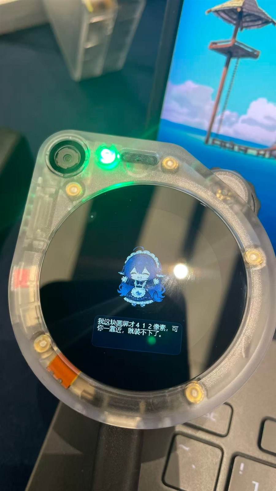
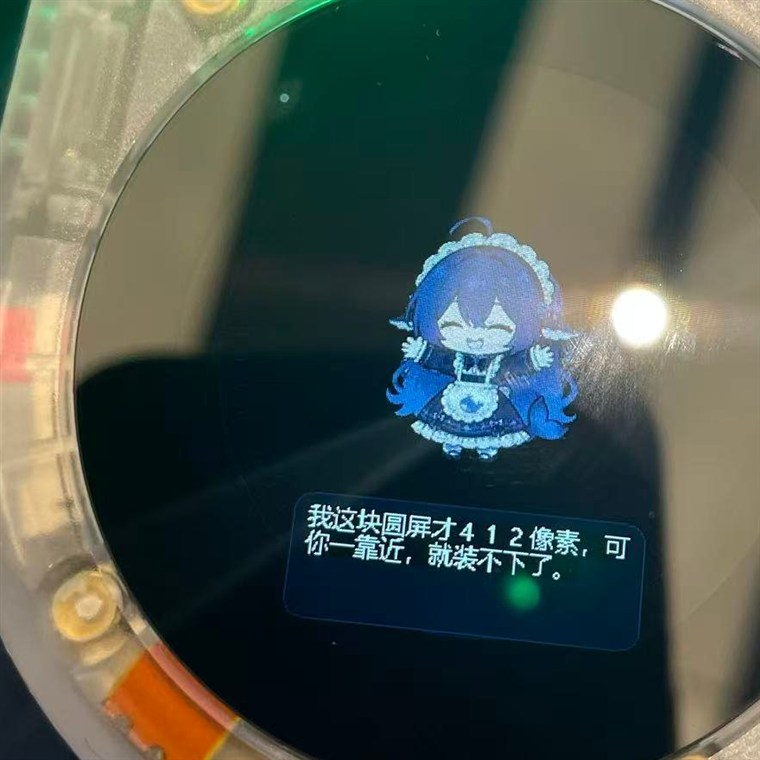

# 鲸鲸 · 具身 Watcher v2（固件 + DSH 桥）

> **给 DeepSeek 酱一个能感知世界的硬件端，让蓝色大肥鱼拥有完整的一生。**

一块 **SenseCAP Watcher（ESP32-S3）** 被改造成会说话、会看、能被人按键打断的小具身设备：
屏幕上有一只桌宠，按一下按键说话，声音上行到电脑做识别，回复用你自己的音色念出来；
需要看一眼时按需拍一张 240×240 的照片。

```
ESP32-S3（鲸鲸） ──WiFi/WebSocket──▶ DSH 插件（桥）──▶ DSH 会话 / LLM
     ▲ 麦克风 / 喇叭 / 相机                       │
     └──────── 下行：say / face / shot / PCM 音频 ─┘
```

本仓库是**完整可编译的工程**：固件源码 + 第三方依赖（vendored）+ 桥插件 + 安装脚本 +
协议契约 + 踩坑手册。**不含任何密钥、WiFi 密码、本机路径，也不含外部参考仓库**。

> **clone 下来直接能编**：`firmware/components/`（Seeed BSP + LVGL）与
> `firmware/managed_components/`（8 个 Espressif 组件）都已随仓库提供，版本锁在
> `main/idf_component.yml` 与 `dependencies.lock` 里。只想核对或升级依赖时，
> 才需要 `install/fetch-deps.ps1`（它会重新拉上游并打 IDF 5.5 补丁）。

| 整机（412 圆屏 + 相机 + 麦克风） | 屏上是桌宠，下面是她刚说的话 |
| --- | --- |
|  |  |

## 目录

| 路径 | 是什么 |
| --- | --- |
| `firmware/` | ESP-IDF 5.5 工程（`hub_v2`）：`main/` 是自有代码，`components/` + `managed_components/` 是随仓库提供的依赖 |
| `firmware/patches/cmake-idf55/` | 上游组件在 IDF 5.5 下必须替换的 5 个 CMakeLists（仓库里的组件已打过） |
| `install/fetch-deps.ps1` | 可选：重新拉 LVGL 8.4 + Seeed BSP 并打补丁（升级依赖或删坏了时用） |
| `bridge/` | DSH 插件 `dsh-embodied-bridge@0.3`（WebSocket 服务 + 能力门控工具 + 面板 + TTS/ASR） |
| `install/install-bridge.ps1` | 交互式装插件：**会问 TTS 引擎与音色**、ASR、端口，写本机配置 |
| `install/flash-firmware.ps1` | 交互式刷固件：问 WiFi/桥地址 → 生成 `wifi_local.h` → build → 烧到 `0xe00000` |
| `skills/dsh-embodied-bridge/SKILL.md` | 给 DSH agent 看的安装/验证/排障手册（放进 `~/.dsh/skills/`） |
| `docs/protocol-v2-contract.md` | 设备 ⇄ 桥的唯一契约（上行 4 / 下行 7 / 不具备 8 带原因），由 `contract.js` 生成 |
| `docs/troubleshooting-2026-10-31.md` | 12 类已踩过的坑，每条带实测数据 |

## 三步上手

```powershell
# 1) 装桥（会问你：TTS 引擎 + 音色 + ASR）
powershell -ExecutionPolicy Bypass -File .\install\install-bridge.ps1
#    然后重启 DSH（插件启动时才加载）

# 2) 刷固件（会问你：WiFi + 这台电脑的局域网 IP）
powershell -ExecutionPolicy Bypass -File .\install\flash-firmware.ps1 -ComPort COM6

# 3) 验证
start http://127.0.0.1:7788/panel
Invoke-RestMethod http://127.0.0.1:7788/health | ConvertTo-Json -Depth 4
```

`/health` 里应看到 `ver=2`、`device.online=true`、`fw=hub_v2`、`ver="0.2"`、`tts.configured=true`。

## 需要什么

- **电脑**：Windows + DSH 桌面版；Node ≥ 18（DSH 自带）；防火墙放行 `7788/tcp` 和 `7789/udp`
  （`7789/udp` 用来被设备自动发现）。
- **设备**：SenseCAP Watcher（ESP32-S3, 32 MB flash / 8 MB PSRAM），USB 串口。
- **刷固件**：ESP-IDF **5.5**（默认路径 `C:\Espressif\v5.5\esp-idf`）+ esptool（IDF 自带）。
- **出声**（任选）：Breeze 云端（要好听）／edge（免费在线）／SAPI（离线机器味）／不出声。
- **收音**（可选）：sherpa-onnx + SenseVoice 模型（常驻进程，约 0.1 s/句）；不给就只听不懂。

## 已经验证过的

- 语音全链：按键 → `voice` 上行 → 落 WAV → ASR → 回复 → TTS 出声
- 按需拍照：`shot` → 240×240 JPEG（约 6 KB / 0.3 s）→ 落盘 + 面板预览
- 表情/桌宠：8 种情绪映射到 3 段内嵌动画
- 长连接稳定性：断线重连后自动重发 `hello`，桥重启也能重新认身份
- 协议一致性：`bridge/test/` 39 条单测 + 端到端 + 契约哨兵全绿

## 已知边界（别指望它做这些）

- **不能**远程触发录音：只能按设备上的物理按键（v2 没有 `record`/`mic` 下行）
- **不上报**电量、表情状态、旋钮数值、环境声；**没有**文本上行（按键录音走 `voice`）
- 24 kHz/16 bit PCM 需要 **48 KB/s** 链路；WiFi 只有 20–30 KB/s 时**长句会卡**（见排障手册 §12）
- 不做周期拍照：只在 `/shot` 被调用时拍一张

## 安全

- 密钥、WiFi 密码只写本机：`~/.dsh/plugins-data/embodied-bridge/config.json`、
  `firmware/main/wifi_local.h`（后者已被 `.gitignore` 忽略）。
- 桥的配置保存接口只允许本机，或带 `panelToken` 的 Bearer。
- 面板会打码所有密钥字段（`breezeApiKey` / `panelToken` / `asrServerCommand` 等）。
- 往 GitHub 推之前先 `git status` 自查一遍：`wifi_local.h`、`plugins-data/`、`config.json`
  都已在 `.gitignore` 里，但别手动 `git add -f`。

## 许可证

自有代码 **MIT**（见 `LICENSE`）；随仓库 vendored 的第三方组件遵循各自许可证，
清单与版本见 **`THIRD_PARTY.md`**（多为 Apache-2.0，LVGL 为 MIT）。

## 致谢 · 参考仓库

这个项目站在三个开源仓库的肩膀上，**没有它们就没有这块能说话的圆屏**：

- **[PC2005-cloud/dsh-pet](https://github.com/PC2005-cloud/dsh-pet)** —— 桌宠的表现方式与动画组织（表情状态机、内嵌动画资源）参考自此。
- **[78/xiaozhi-esp32](https://github.com/78/xiaozhi-esp32)** —— 设备端的音频链路、WebSocket 通信与"小智式"交互范式（按键说话、屏上文字、灯语）的重要参照；本项目在 ESP32-S3 上重写了应用层，但很多工程判断来自这里踩过的坑。
- **[Seeed-Studio/SenseCAP-Watcher-Firmware](https://github.com/Seeed-Studio/SenseCAP-Watcher-Firmware)** —— 硬件 BSP（屏/触摸/音频/IO 扩展/摄像头）与其组件来源；`firmware/patches/` 里的 IDF 5.5 补丁也是在它基础上改的。

另外感谢 [lvgl/lvgl](https://github.com/lvgl/lvgl)（GUI）与 ESP-IDF 团队。
各上游的许可证与版本见 `THIRD_PARTY.md`。
